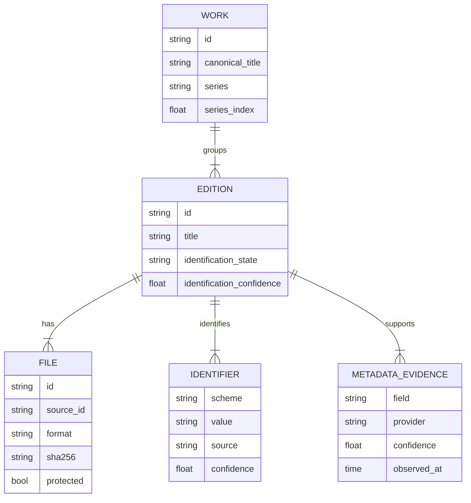
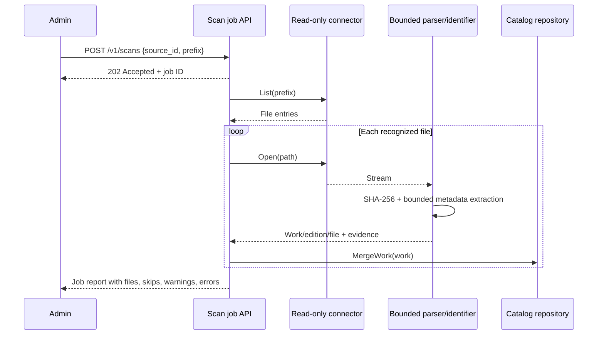
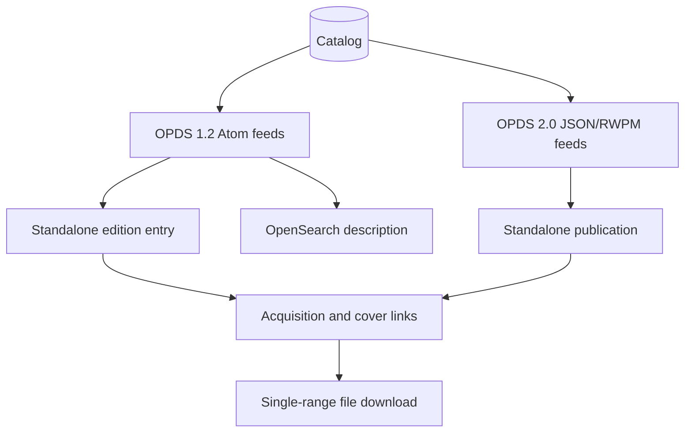
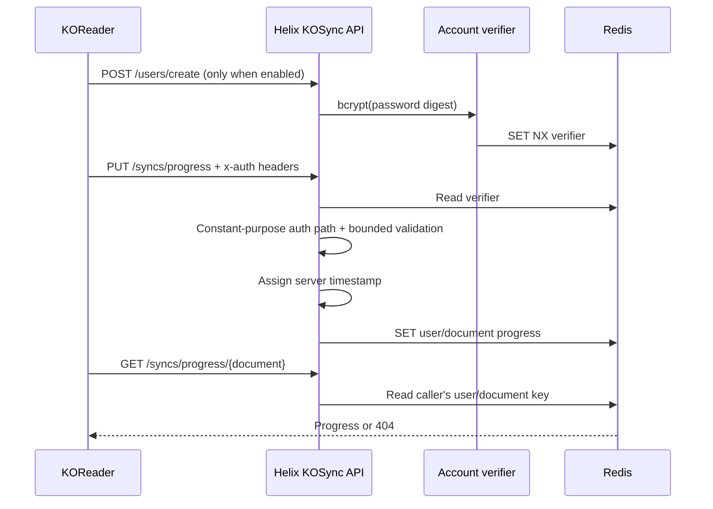
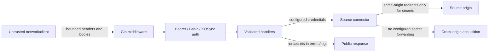
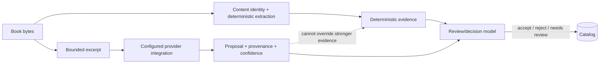

# Helix Reader — Implemented Architecture

## Scope

These diagrams describe current code paths and explicit integration boundaries. Dashed nodes are prototypes, optional components, or unfinished integrations; they are not production capabilities.

## Runtime topology

```mermaid
flowchart LR
    P[Responsive React prototype\nsample memory only] -. no API connection .-> API
    R[Third-party OPDS readers] -->|OPDS 1.2 / 2.0| API
    K[KOReader clients] -->|account + document progress| API
    A[Admin/API client] -->|Bearer token| API
    API[Go/Gin HTTP service\nHTTP/1.1; HTTP/2 or HTTP/3 with TLS] --> C{Catalog repository}
    C -->|configured| PG[(PostgreSQL)]
    C -->|fallback with warning| MEM[(Volatile memory)]
    API -->|progress + KOReader sync| RD[(Redis)]
    API -->|optional vector memory| PV[(pgvector)]
    API --> CC[Validated cover cache]
    API --> ING[Read-only ingestion]
    ING --> SRC[Local / mounts / HTTP(S)\nWebDAV / OPDS / rclone]
```

The web prototype does not call the API. Native desktop/mobile applications, real content renderers, external conversion engines, OIDC, Kobo sync, OPDS-PSE, and LCP fulfillment are not shown as connected because they are not implemented.

## Catalog identity



ISBNs and other edition identifiers are not collapsed onto the work as metadata fields. Work and edition IDs use a deterministically selected canonical ISBN-13 when available, with content SHA-256 as the no-valid-ISBN fallback. ISBN-10/13 equivalents, hyphenation, scheme labels, and identifier ordering cannot fork identity, whether or not the optional identification pipeline runs; every file independently retains its byte hash and stable, case-sensitive source/path ID. Different byte streams carrying the same ISBN therefore share one work/edition as multiple files instead of colliding. When no-ISBN bytes change, the source/path file is re-homed to the new content work and an emptied old work is removed. Ingestion merges through one atomic repository operation. PostgreSQL serializes cross-work identity writes with a transaction-scoped advisory lock; the memory repository applies equivalent re-homing under its write lock and returns deep copies. Successful, unprefixed scans of connectors with recursive listings atomically remove catalog files absent from the complete source snapshot, then remove editions and works emptied by that deletion. Per-source lock stripes prevent an older concurrent listing from pruning newer scan results. Prefix scans, non-recursive sources, canceled/failed listings, and listed files whose ingest fails never authorize pruning.

## Ingestion sequence



Scan jobs and source registrations currently live in process memory. They are not durable schedules or a watch-folder service. Administrators can supply a validated stable source ID and reuse it after restart to reattach existing source/path file identities; changing that ID defines a different source and can duplicate files. The runner permits two active scans and 64 unfinished jobs, retains a bounded terminal history, contains worker panics, observes queued/running cancellation, and drains workers before connector shutdown. Scan admission holds the source read lock through job registration; deletion takes the source write lock and rejects sources with unfinished scans, preventing connector closure during the admission gap or active ingestion. Indexing never requires moving or rewriting originals. Full recursive scans report the number of stale catalog files removed; OPDS pagination caps fail closed rather than returning a partial snapshot.

## OPDS surfaces



OPDS-PSE links and page extraction are not currently emitted. Detection or streaming of CBZ/PDF does not establish page rendering.

## Internal progress and KOReader compatibility



The separate internal `/v1/sync/progress` API stores structured positions and vector clocks and resolves concurrent updates deterministically. It is not wire-compatible with KOReader; the KOSync surface exists to bridge that protocol difference.

## Trust and credential boundaries



Local connectors resolve final symlink targets and enforce source-root containment. Plain HTTP/WebDAV sources reject cross-origin redirects in the redirect callback before the new origin receives a request. HTTP clients bound connection and response-header establishment without imposing a whole-body deadline on long book transfers; request contexts still cancel active streams. Remote source output and cover downloads are bounded. OPDS acquisition dials validate every resolved cross-origin address and pin the connection to the validated IP; private/loopback destinations require an explicit source opt-in, while link-local and other restricted ranges remain forbidden. Configured credentials are stripped on origin changes. OPDS catalog file paths contain only credential-free acquisition URLs; signed URLs are retained solely in the connector’s mutex-protected process-local map for the current source session and cleared on close. Distinct query-addressed books receive deterministic synthetic `helix-x-` key fragments instead of collapsing; order-independent new groups plus previous-generation key reuse keep identities stable through feed reorder and membership changes. Complete listings atomically replace/prune the raw-URL generation without exposing queries to catalog storage. Because source registrations and those mappings do not survive restart, signed remote sources must be re-registered with their stable source ID and rescanned before their content can be opened again. Scan-job errors and report locations redact URL userinfo, queries, and fragments before persistence in process-local job records. Cover downloads validate public IP targets, redirect limits, decoded image type, dimensions, and atomic cache writes. Secrets are configuration inputs, never catalog metadata or evidence content.

## AI decision boundary



pgvector memory is optional and dimension-checked. Current code does not establish every external LLM provider or content renderer. Provider names and strategy labels never promote a proposal to verified metadata or a format to rendered status.
