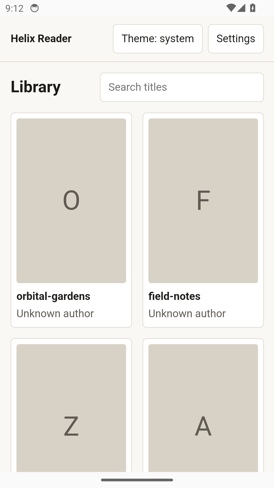
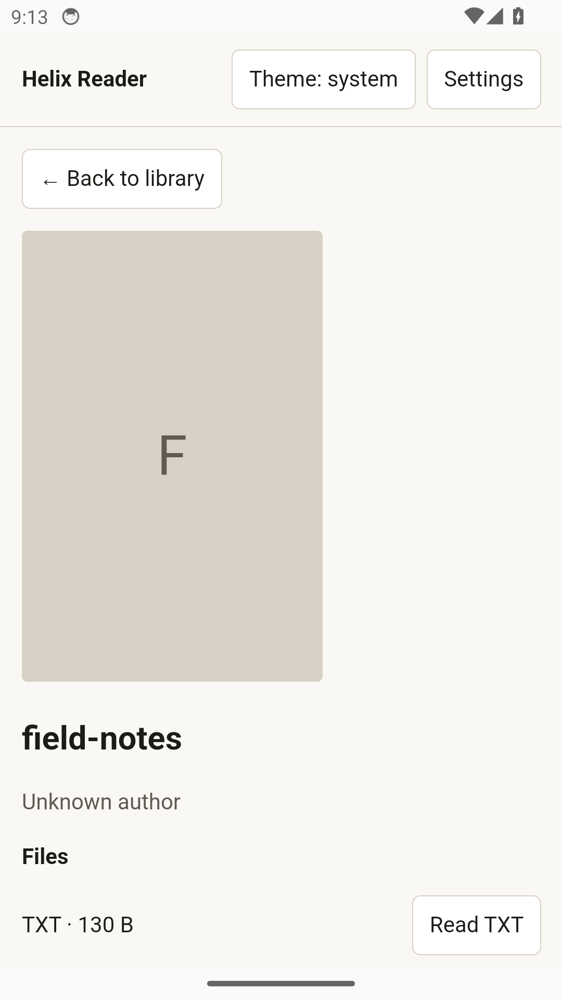
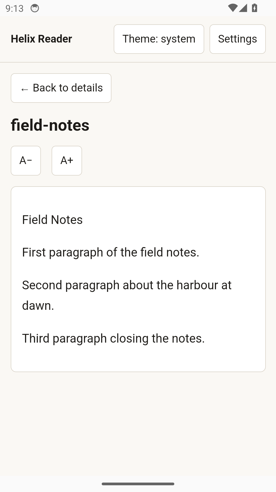
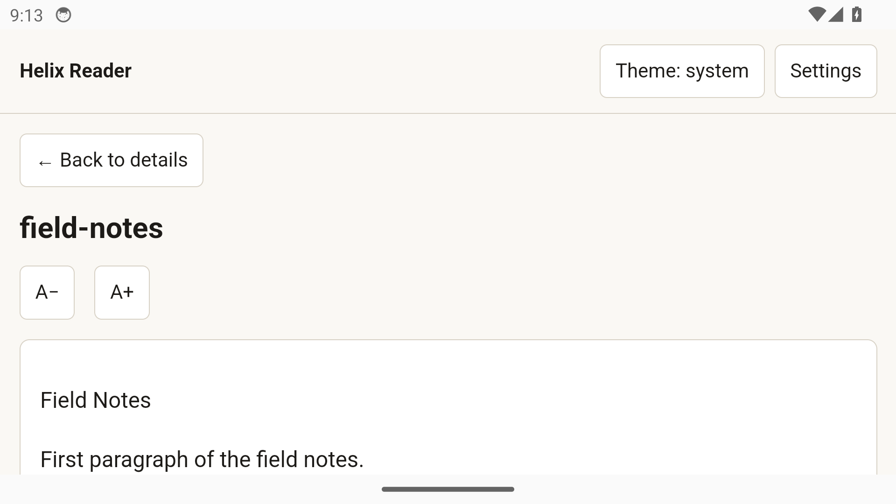

# Android client manual (`clients/android`)

**Provenance, read first.** These four images were **not** produced by the HRD-076 capture runs. They are the tracked captures of the
earlier HRD-022 run (`evidence/clients/android/run-20261123T211340Z/`, see its `RUN.txt` and `MANIFEST.sha256`): the debug APK
(`org.helixreader.app`, versionName 1.0, versionCode 1; sha256 in `evidence/clients/android/helix-reader-debug.apk.sha256`) installed in an
Android 14 / API 34 google_apis x86_64 emulator that ran inside a rootless podman container (`-no-window -no-audio`, no host display).
Their sha256 values are re-computed in
[`evidence/screenshots/android/capture_manifest.json`](../../evidence/screenshots/android/capture_manifest.json). That run drove the emulator
from the host with `adb` (connect, reverse, `input tap`, rotation) against a throwaway local server; the tracked runner script for the
emulator (`tools/isolation/run_android_emulator.sh`) is not on `main`, so **HRD-076 could not repeat the capture with a guard-clean,
container-only driver**. Anything beyond these four views is UNCONFIRMED.

The library is the HRD-022 fixture (four works, including two plain-text files), not real books.

## Library (portrait, 1080x1920)

The Android app is the web client in a WebView, so the library, search box and theme button are the ones described in the
[web client manual](web_client_manual.md).

## Work details

## Reader: portrait and landscape

A screen recording of the run is tracked as `evidence/clients/android/run-20261123T211340Z/run_screenrecord.mp4`
(sha256 `d19def5e6bfe088f7a5d9298078ba3a46cf6642bb1face2eeabba5b52ab889c8`, recorded by the emulator's `screenrecord`).

## UNCONFIRMED

- No Android capture was taken by this task: the emulator image exists and `/dev/kvm` is available, but the sanctioned driver is missing (above).
- Settings form, search, paging, dark theme and the EPUB notice on Android.
- Real devices and any Android version other than 14.
