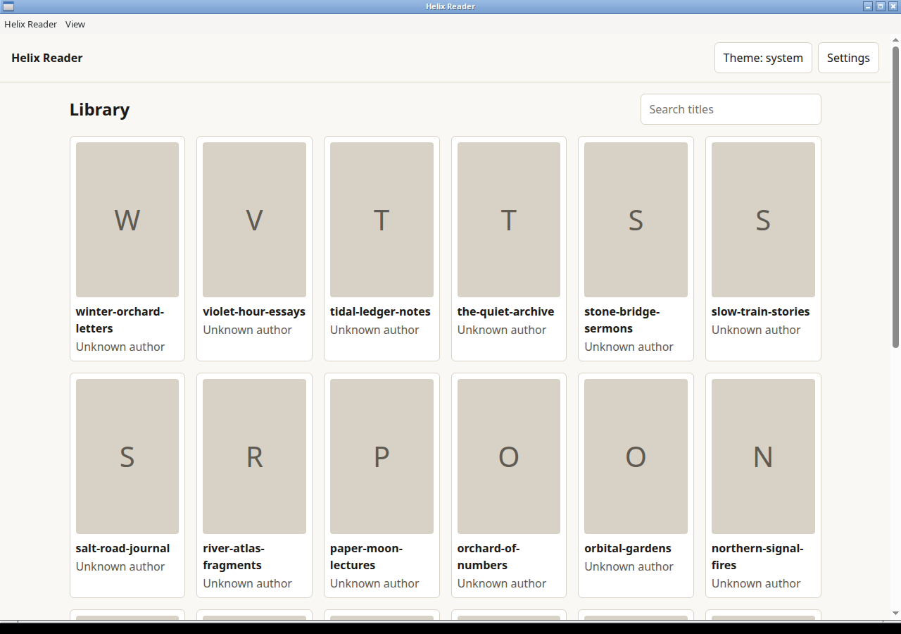
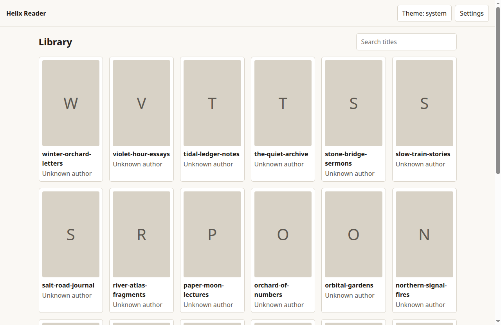
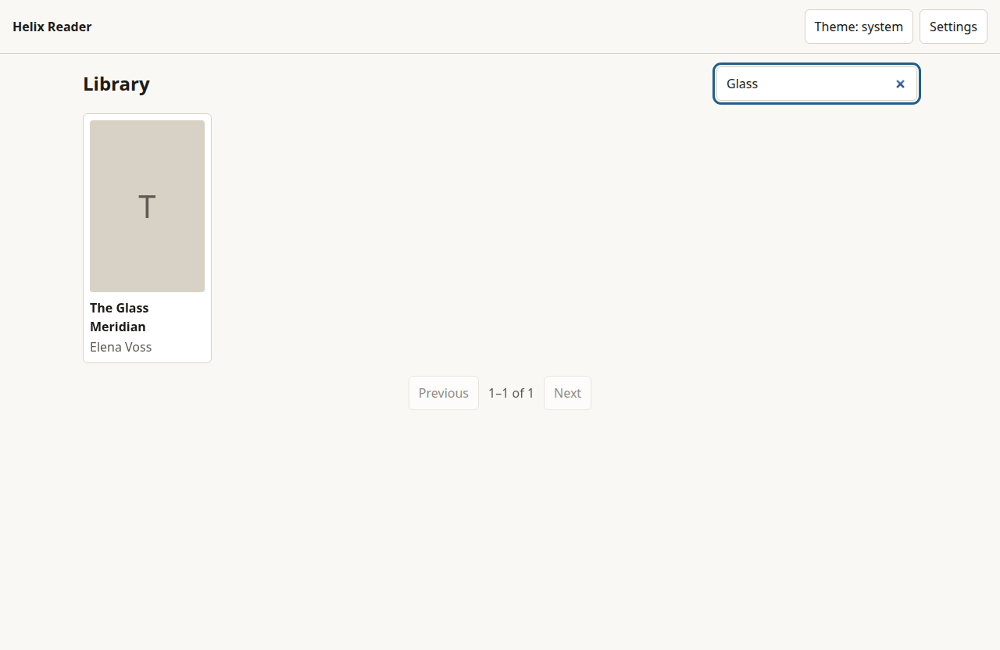
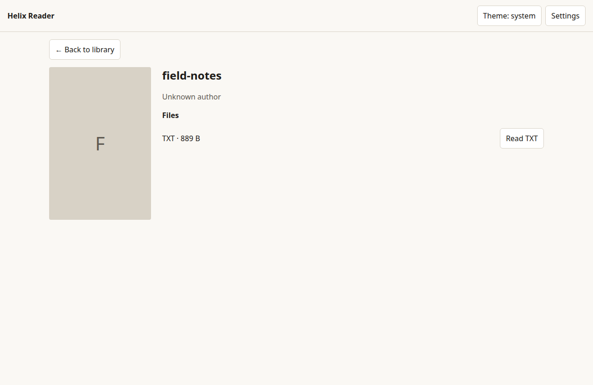
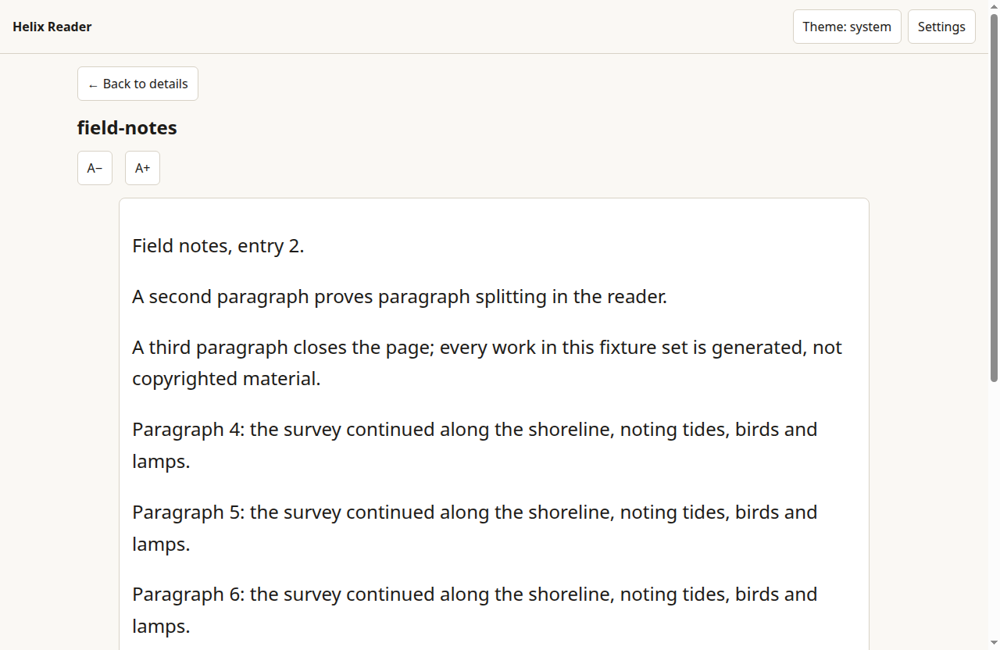
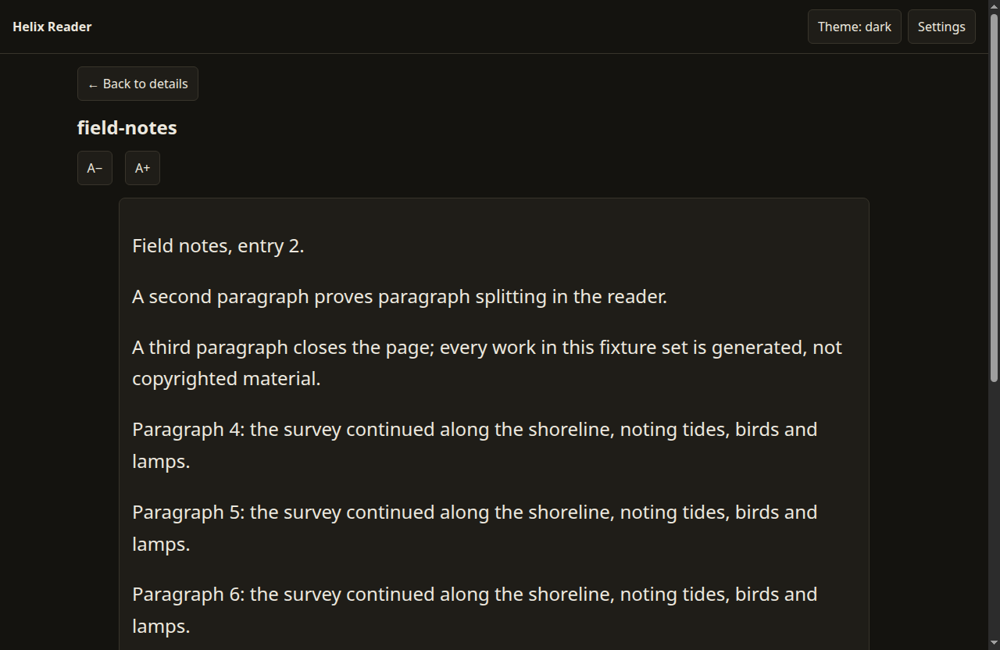

# Linux desktop client manual (`clients/desktop`)

The desktop client is an Electron shell (Electron 45.4.1, Chromium 156) around the web client. The capture below is the packaged
`helix-reader-linux-x64` build (app version 0.1.0) started inside the isolated container on its private Xvfb display
(`qa/isolation/run_capture_desktop.sh`; no host display, no host network). Manifest:
[`evidence/screenshots/desktop/capture_manifest.json`](../../evidence/screenshots/desktop/capture_manifest.json), sealed with `SHA256SUMS`.

The packaged build under test was produced from the repository state of the earlier desktop packaging work (`clients/desktop/out`); this
task did not rebuild it. The web assets inside it therefore show the same UI as `clients/web` 0.1.0.

## Start-up and the whole window

The app signs in at launch from its stored connection (here supplied through the QA environment variables described in
`clients/desktop/README.md`). This is the full container X screen, window frame and menu bar included:

The page area alone:

## Search, details, reader, text size, dark theme

Connection settings (server URL, username, password) are edited through the menu **Helix Reader > Connection**; the password is encrypted
with Electron `safeStorage` when an OS keystore exists and is otherwise kept in memory only (see `clients/desktop/README.md`).

## Video

[`desktop-walkthrough-steps.webm`](../../evidence/screenshots/desktop/desktop-walkthrough-steps.webm) is a **step video**: one real frame of
the container's Xvfb screen per step, played at 1 frame per second. It is a slideshow of real frames, not a continuous screen recording
(the ffmpeg shipped with Playwright has no screen-grab input, and with Playwright `recordVideo` enabled for Electron, page screenshots timed out in this setup, so it was dropped).

## UNCONFIRMED

- Windows and macOS builds are not captured (blocked, see `clients/supported-platforms.json`).
- The Connection dialog itself was not captured; only the library, search, detail and reader flows were.
- Whether the renderer sandbox is on in these captures: the capture ran with `HELIX_DESKTOP_NO_CHROMIUM_SANDBOX=1`, the container default.
