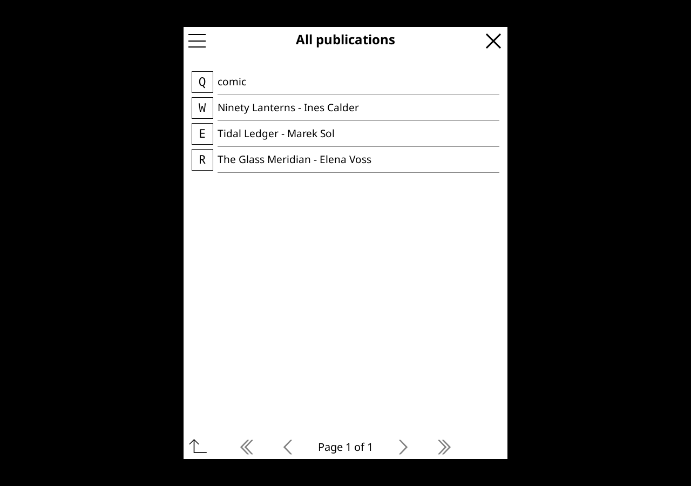

# KOReader client manual

Helix Reader serves KOReader through standard protocols, so no plugin is required: **OPDS 1.2** for browsing and downloading, **OPDS-PSE**
for streaming comic pages, and **KOSync** for reading-position sync. The images below are real captures of KOReader v2026.07 (the Linux
emulator build) running on a private Xvfb display inside the isolated container (`qa/isolation/run_koreader_gui.sh`; no host display,
`--network none`, only the unix-socket bridge to a throwaway helix-server). Manifest:
[`evidence/screenshots/koreader/capture_manifest.json`](../../evidence/screenshots/koreader/capture_manifest.json). The visible reader is
the white 600x800 panel inside the 1280x900 screen.

## Browse and download over OPDS

Add the catalog `http://<server>/opds/1.2` in **Search > OPDS catalog** (username and password of the server account). The catalog root
and "All publications":

Choosing a work downloads it into KOReader's Books folder (the file manager before the first download is
[`A01_filemanager.png`](../../evidence/screenshots/koreader/A01_filemanager.png)); opening it shows page 1:

## Reading-position sync (KOSync)

Point **Progress sync** at `http://<server>/kosync`. Two KOReader profiles (two "devices") were used. Profile A turned to page 4 of 9 and
pushed `0.4444`; profile B opened the same book and was moved to page 4:

B then turned to page 6 (push `0.6666`) and A, on re-opening, was moved to page 6:

The machine verdict of the sync (pushes, pulls, percentages, redis sink content) is
[`kosync_proof.json`](../../evidence/screenshots/koreader/kosync_proof.json): `verdict: PASS`. The screenshots show it; the JSON proves it.

## Comics streamed page by page (OPDS-PSE)

A CBZ is opened as a stream: KOReader requests each page from the server on demand. The fixture pages are solid colours on purpose so the
harness can read a pixel and tell page 1 from page 2:

## UNCONFIRMED

- No KOReader video was recorded (still frames only).
- Real e-ink devices (Kobo, Kindle, PocketBook) were not exercised; only the emulator build on Linux.
- The CBZ fixture pages are solid colours, not real artwork.
- Page numbers (4, 6 of 9) belong to the generated fixture book and will differ for other books.

See also: [tutorial](../tutorials/koreader_opds_and_sync.md), [screenshot index](../screenshots.md).
