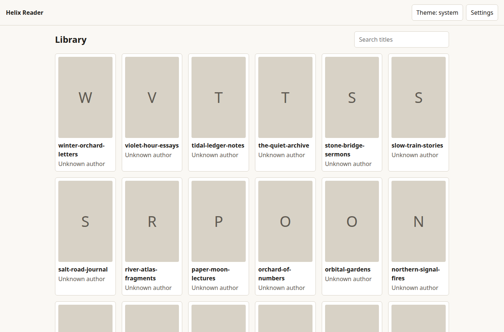
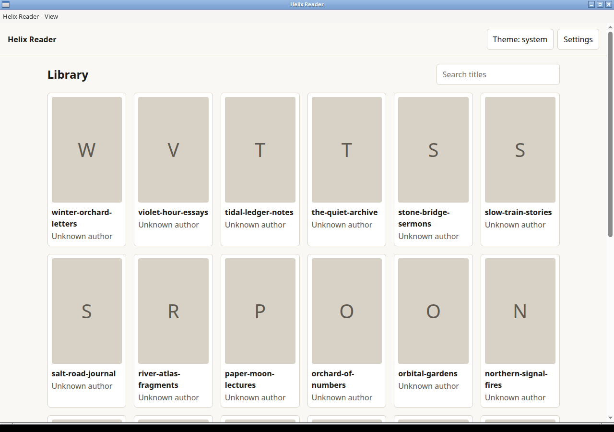

# Quick start: server, then a client in five steps

This page gets a local Helix server running with a small library and shows the result in each client. Every screenshot is a real capture
from the isolated container runner; see [`screenshots.md`](screenshots.md) for how they were made and what is not captured.

1. **Build and start the server** (volatile in-memory catalog, loopback only):

   ```bash
   cd server && go build -o /tmp/helix-server ./cmd/helix-server
   export HELIX_ADMIN_TOKEN="$(head -c18 /dev/urandom | base64 | tr -dc A-Za-z0-9)"   # exported: step 2 reuses it in this shell
   HELIX_ADDRESS=127.0.0.1:8080 HELIX_OPDS_USERNAME=reader HELIX_OPDS_PASSWORD=choose-a-password /tmp/helix-server &
   ```

   Run step 2 in the same shell (the token is exported there). Use your own admin token and password; never commit them. Details and every variable: [`user_guide.md`](user_guide.md#server-quickstart).

2. **Register a folder of books and scan it** (management API, admin bearer token):

   ```bash
   curl -XPOST http://127.0.0.1:8080/v1/sources -H "Authorization: Bearer $HELIX_ADMIN_TOKEN" \
        -d '{"id":"my-library","protocol":"local","root":"/path/to/books"}'
   curl -XPOST http://127.0.0.1:8080/v1/scans -H "Authorization: Bearer $HELIX_ADMIN_TOKEN" \
        -d '{"source_id":"my-library","prefix":""}'
   ```

   Source registrations are process-local: repeat them after a restart (see the user guide).

3. **Web client.** `cd clients/web && npm ci && npm run build`, then serve `dist/` and point it at the server (the **Settings** form takes
   the address, username and session-only password). Walk-through with screenshots: [`manuals/web_client_manual.md`](manuals/web_client_manual.md).

   

4. **Linux desktop client** (Electron shell around the web client): [`manuals/desktop_client_manual.md`](manuals/desktop_client_manual.md).

   

5. **KOReader** reads the OPDS catalog at `/opds/1.2` and syncs positions through the KOSync endpoints:
   [`manuals/koreader_manual.md`](manuals/koreader_manual.md) and the tutorial [`tutorials/koreader_opds_and_sync.md`](tutorials/koreader_opds_and_sync.md).

   Android: [`manuals/android_client_manual.md`](manuals/android_client_manual.md) (reused earlier capture, provenance stated there).

## Next

- A guided tour of the web and desktop clients: [`tutorials/first_library_tour.md`](tutorials/first_library_tour.md).
- Questions: [`faq.md`](faq.md).

Steps 1 and 2 were executed for real against a locally built server (source registered 201, scan accepted 202, OPDS root 200); the
transcript is [`evidence/screenshots/tooling/quickstart_run.txt`](../evidence/screenshots/tooling/quickstart_run.txt). That run was on host loopback
(a non-GUI process), not inside the container. Steps 3 and later were not re-executed from this page.
