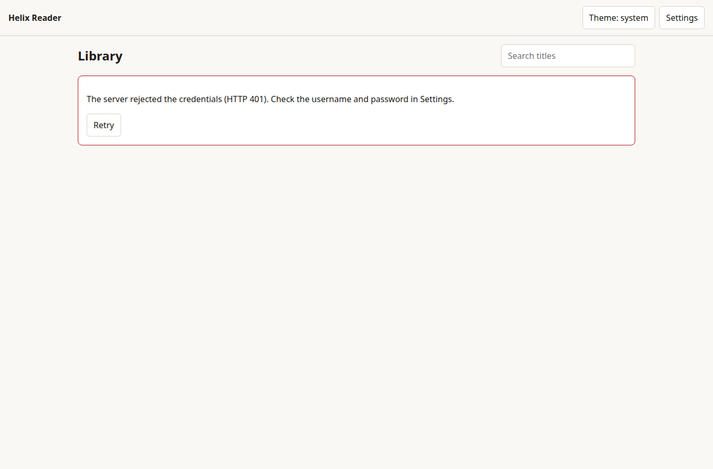
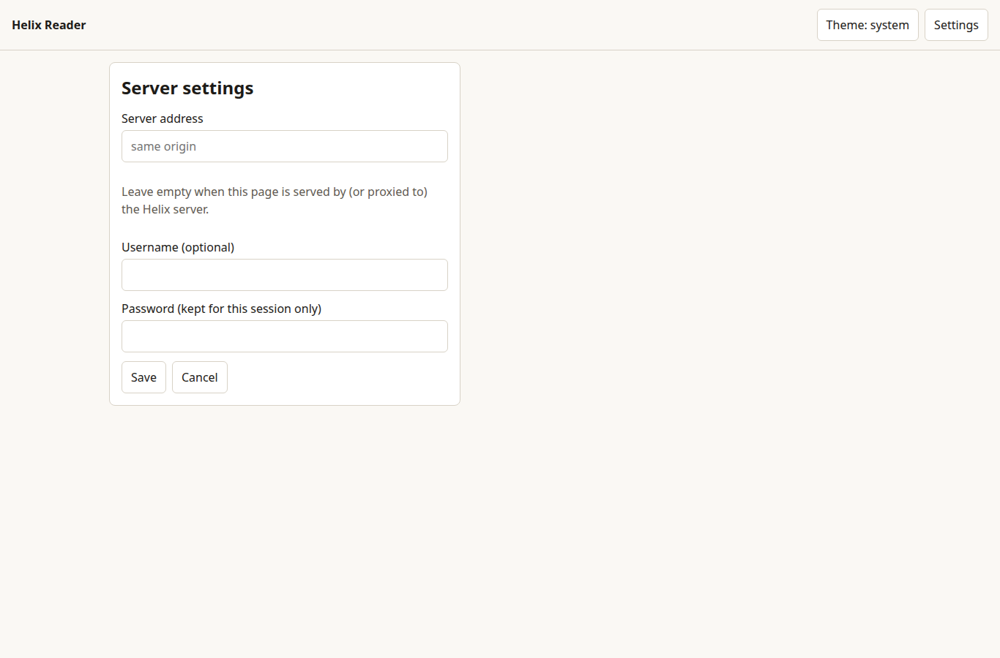
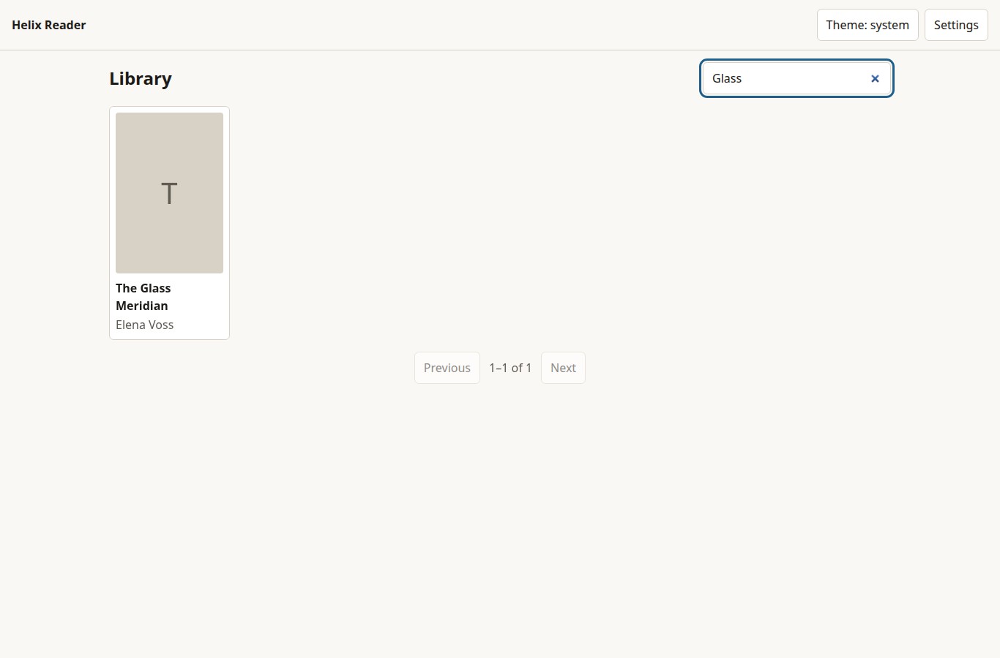
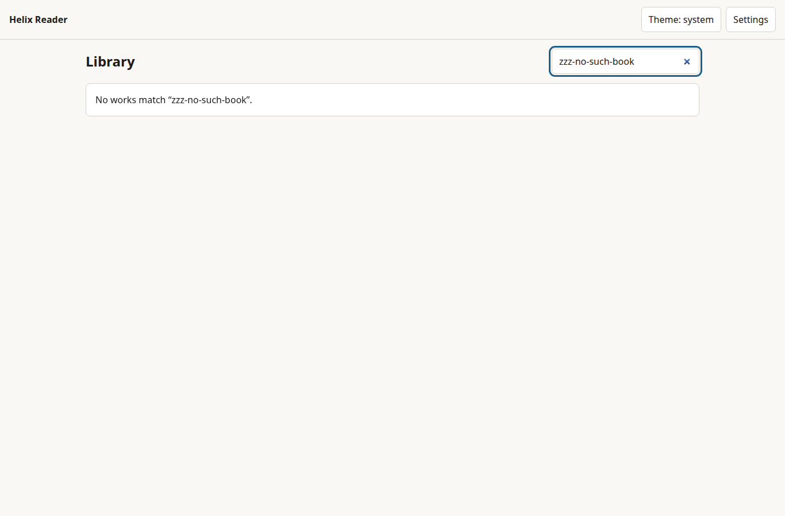
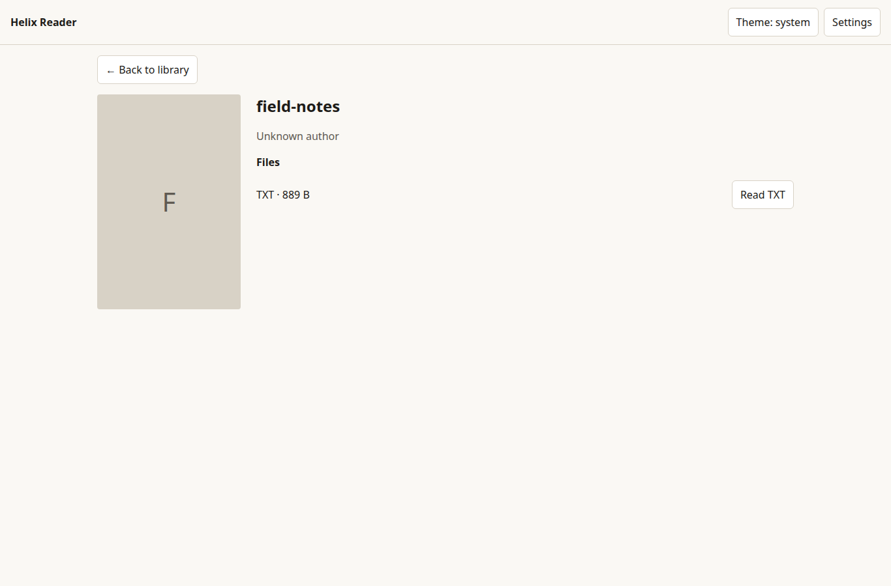
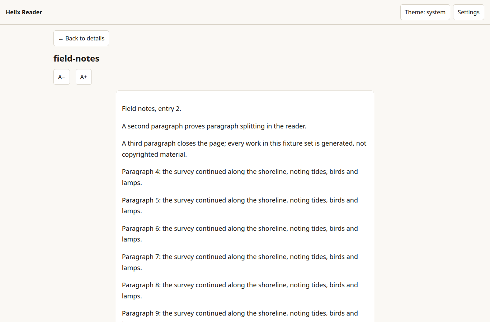
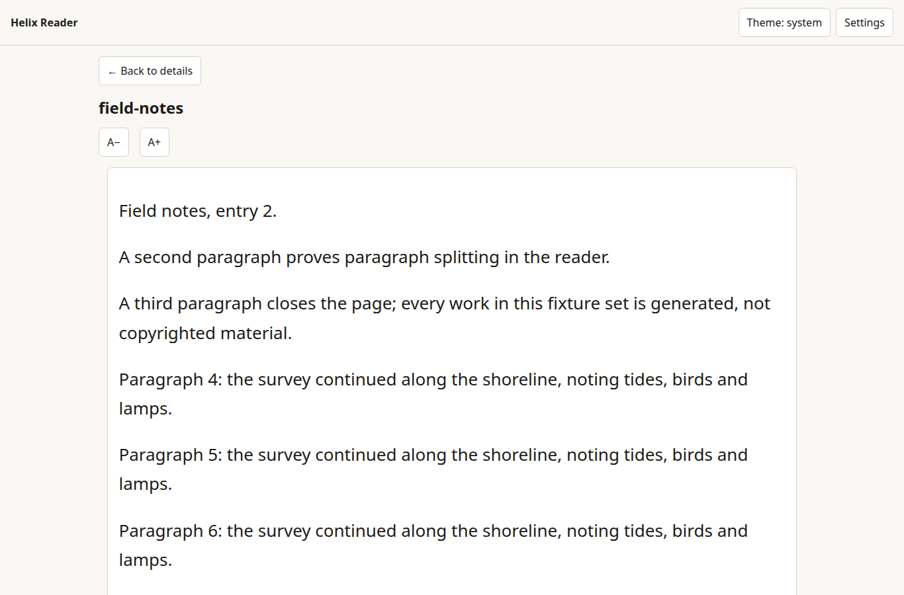
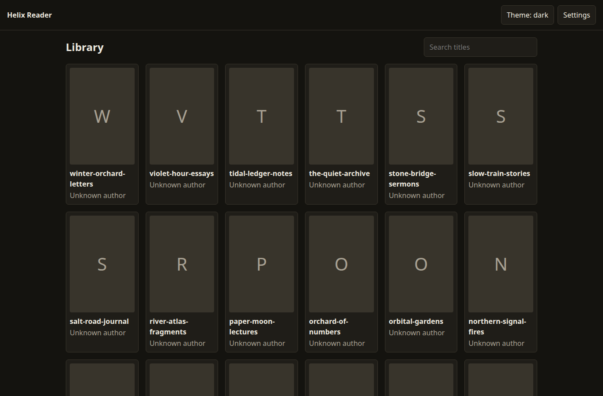
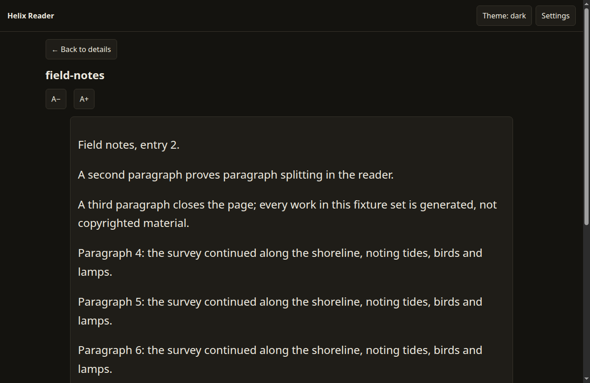

# Tutorial: a first tour of your library in the web and desktop clients

Goal: sign in, find a work with server-side search, read it, and change the text size and theme. About five minutes. Prerequisite: a running
server with a scanned library ([quick start](../quickstart.md)). The screenshots come from a generated 27-work fixture library.

## 1. Sign in

Open the client. Without credentials it tells you the server rejected the request; open **Settings** and enter the server address,
username and password.

## 2. Find a work

Type in **Search titles**. The server does the matching; `Glass` leaves one work out of 27.

Nothing matching? You get an explicit empty state rather than a blank grid.

## 3. Open and read

Clear the search, open a plain-text work, press **Read TXT**.

## 4. Make it comfortable

**A+** four times makes the text 26 px; the **Theme** button in the header cycles system, light, dark.

## 5. The same in the desktop client

The Linux desktop client shows the same screens in its own window:

## What this tutorial does not cover

EPUB reading (the web and desktop clients say they do not render EPUB and offer the original for download; use KOReader, see
[`koreader_opds_and_sync.md`](koreader_opds_and_sync.md)).
