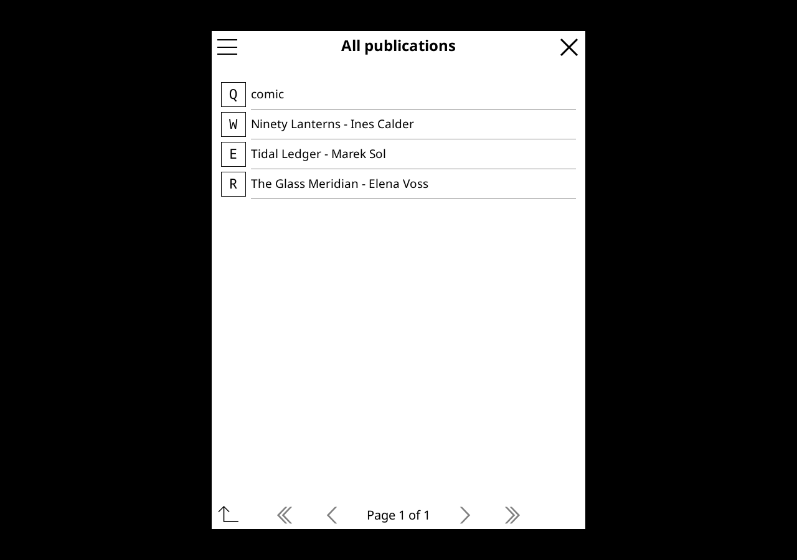
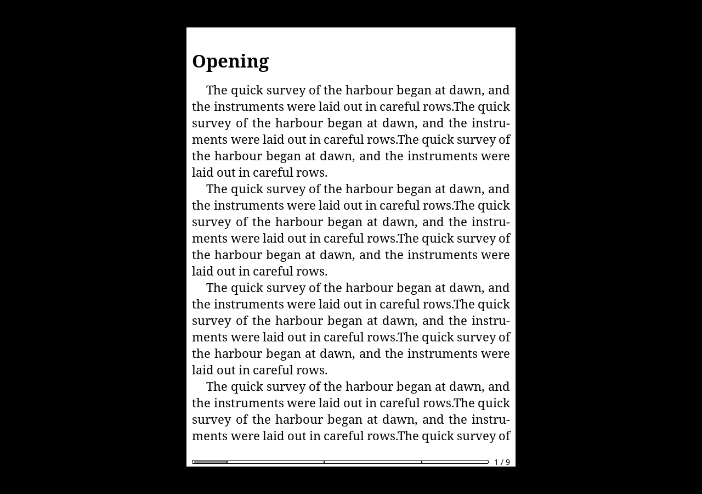
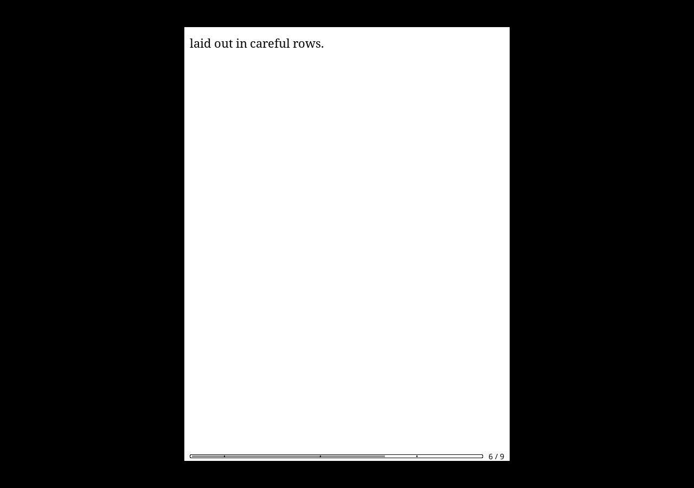

# Tutorial: KOReader with OPDS and reading sync

Goal: read a book from your Helix Reader library in KOReader and continue on a second device at the same page. Every screenshot is a real
capture (see [`../manuals/koreader_manual.md`](../manuals/koreader_manual.md) for provenance and the UNCONFIRMED list).

1. **Make sure the server runs** and you have a user (see [`../quickstart.md`](../quickstart.md)). OPDS lives at `/opds/1.2`, KOSync at `/kosync`.
2. **Add the catalog.** In KOReader: search icon > OPDS catalog > add `http://<server>/opds/1.2`, with your server username and password.
3. **Open "All publications"** and pick a work to download:

   
4. **Open the book.** It starts on page 1:

   
5. **Enable Progress sync** (tools menu > Progress sync) with `http://<server>/kosync` and the same credentials. Turn some pages; KOReader pushes
   the position (here page 4 of 9, `0.4444`):

   
6. **On the second device**, add the same catalog and sync account and open the same book. The reader jumps to the stored position:

   
7. **Continue** on the second device; its position flows back the same way (page 6 below), and the first device lands on page 6 when re-opened:

   
8. **Comics:** choose a CBZ entry that offers streaming; pages arrive one at a time ([page 1](../../evidence/screenshots/koreader/B05_pse_page1.png),
   [page 2](../../evidence/screenshots/koreader/B06_pse_page2.png)).

Troubleshooting: a 401 from the catalog means wrong credentials (the web client shows the same state in
[`web-error-401-before-sign-in.png`](../../evidence/screenshots/web/web-error-401-before-sign-in.png)); the sync proof of the run above is
[`kosync_proof.json`](../../evidence/screenshots/koreader/kosync_proof.json).
